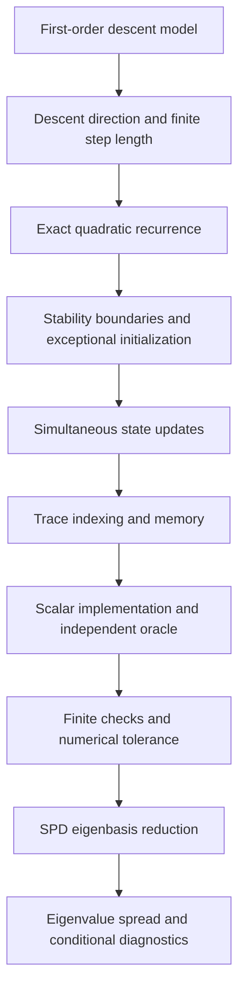

# Gradient Descent

## Learning path

1. [[01 - Why Local Descent Works]]
2. [[02 - Deriving the Update and Its Limits]]
3. [[03 - Tracing the Algorithm]]
4. [[04 - Implementing and Testing Descent]]
5. [[05 - Curvature and Failure Analysis]]

## Concept prerequisites

| Concept | Canonical chapter | Prerequisites |
|---|---|---|
| First-order descent model | [[01 - Why Local Descent Works#Why Local Descent Works|Why Local Descent Works]] | none |
| Descent direction and finite step length | [[01 - Why Local Descent Works#Why Local Descent Works|Why Local Descent Works]] | gd.c1 (covered) |
| Exact quadratic recurrence | [[02 - Deriving the Update and Its Limits#Deriving the Update and Its Limits|Deriving the Update and Its Limits]] | gd.direction (covered) |
| Stability boundaries and exceptional initialization | [[02 - Deriving the Update and Its Limits#Deriving the Update and Its Limits|Deriving the Update and Its Limits]] | gd.c2 (covered) |
| Simultaneous state updates | [[03 - Tracing the Algorithm#Tracing the Algorithm|Tracing the Algorithm]] | gd.boundary (covered) |
| Trace indexing and memory | [[03 - Tracing the Algorithm#Tracing the Algorithm|Tracing the Algorithm]] | gd.c3 (covered) |
| Scalar implementation and independent oracle | [[04 - Implementing and Testing Descent#Implementing and Testing Descent|Implementing and Testing Descent]] | gd.trace (covered) |
| Finite checks and numerical tolerance | [[04 - Implementing and Testing Descent#Implementing and Testing Descent|Implementing and Testing Descent]] | gd.c4 (covered) |
| SPD eigenbasis reduction | [[05 - Curvature and Failure Analysis#Curvature and Failure Analysis|Curvature and Failure Analysis]] | gd.tolerance (covered) |
| Eigenvalue spread and conditional diagnostics | [[05 - Curvature and Failure Analysis#Curvature and Failure Analysis|Curvature and Failure Analysis]] | gd.c5 (covered) |
