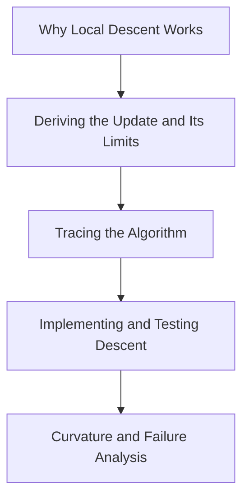

# Gradient Descent

## Learning path

1. [[01 - Why Local Descent Works]]
2. [[02 - Deriving the Update and Its Limits]]
3. [[03 - Tracing the Algorithm]]
4. [[04 - Implementing and Testing Descent]]
5. [[05 - Curvature and Failure Analysis]]

## Concept prerequisites

