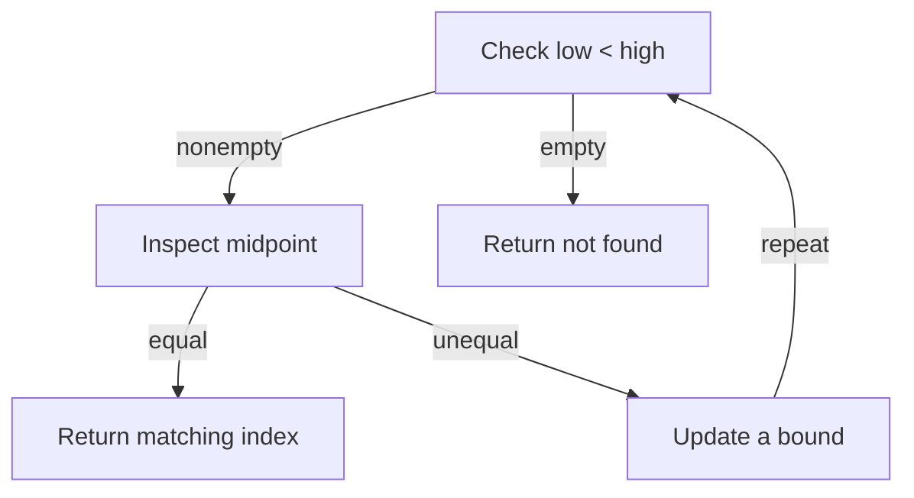

# Binary Search with Half Open Intervals — prepared visual demonstration

These are actual prepared representations. The associated adaptive chapter plan remains planned; no complete teaching collection or semantic review is claimed.

## Loop Invariant

Native Mermaid source is generated and checked against bounded semantic nodes and edges; browser rendering is not asserted.

## Finding a Match

![[assets/scriptorium/165eb3341d172bcfc50423646175862ba956d18c741d3e90d14b712c4566dba0.svg]]

The states below were produced by the binary-search implementation in this reproduction script, with high always exclusive.

[Open interactive state sequence](../../assets/scriptorium/8f94cb6a183d826a0a20e8577b84ad23cfa9dfff5b277da3703b0c3341dd1dc8.html)

This HTML slider displays observed algorithm states. It executes no user-provided code and is opened as a standalone file.
