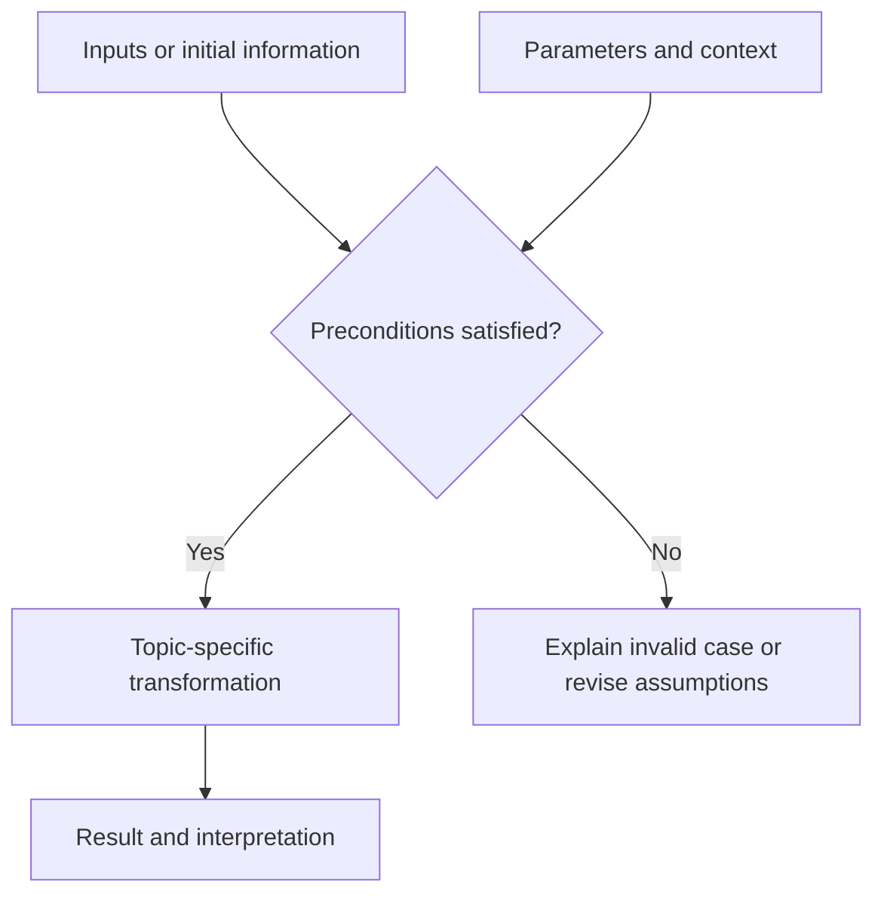

# <nn>. <Subtopic Title>

> [!abstract] Key Equations
> - **<Equation Name>:**
>   $$<Display LaTeX Equation>$$

<!-- AUTHORING GUIDANCE: Keep these exact 7 sections and order. Adapt non-mathematical topics to evidence/logic while retaining all headings. Define symbols in Section 2 before later equations. Reuse one named running example across Sections 3–5. Cite primary claims inline and list exact locations in Section 7; label missing evidence [UNVERIFIED]. Keep uncreated future topics as plain text. -->

<!-- SECTION: S1-SYNTHESIS -->
## 1. Executive Synthesis & Architectural Significance

### Core Problem & Computational Purpose
<In 3–4 symbol-free sentences: define the subtopic, state the problem/inputs/output, and explain the exact limitation of a simpler approach and when that simpler approach still works.>

- **Learning outcome:** <What the reader can explain, solve, implement, or evaluate.>
- **Scope:** <Formulation, level, main validity conditions, and nearby topics treated elsewhere.>
- **Practical recognition:** <Problem cue favoring this concept and one condition favoring an alternative.>

### Governing Mechanism & Unbreakable Invariant
<In 2–3 sentences: explain the central mechanism and state the governing invariant (identifying definition, theorem, assumption, observation, or heuristic) with its domain; reserve full notation/proof for Sections 3–4.>

- **Validity boundary:** <Key condition outside which the mechanism or conclusion changes.>
- **Success criterion:** <How a correct result is recognized in the motivating setting.>

### Position in the Broader Architecture
- **Taxonomic Lineage:** `<Base Domain>` $\to$ `<Master Topic>` $\to$ `<Parent Topic>` $\to$ **`<Subtopic Title>`**
- **Systemic Role:** <In 2–3 sentences: state direct prerequisite inputs, downstream consumers, and one real application interface.>
- **Conceptual Mental Model:** <One-sentence mental model mapping main parts without adding unstated assumptions.>


<!-- SECTION: S2-CONTEXT -->
## 2. Building Blocks & Deep Historical Context

> [!note] Zero-Baseline Prerequisites
> Introduce terms in dependency order (object, operation, relation, notation) before using them in equations.
> - **<Term 1> ($x_i$):** <Physical/logical meaning, type/domain/units, index range, and tiny concrete example.>
> - **<Term 2> ($\sum_{i=1}^{d}$):** <Operation name, index bounds, and action on a small explicit collection.>
> - **<Term 3> ($\theta$):** <Parameter role, admissible values, fixed vs. learned, and small example (or topic-relevant parameter).>
> - **<Additional prerequisite or convention>:** <Cover all remaining symbols, vector orientation, indexing, and sign conventions.>
> - **Readiness check:** <Small prerequisite task, short answer, and concept to revisit if needed.>
> - **Prerequisite connections:** <Link existing vault notes (`[[Exact Filename|Title]]`) and state the specific skill/result needed.>

### Historical & Engineering Motivation (Why This Had to Be Invented)

#### The Pre-Invention Bottleneck
<In 4–5 sentences: prior problem setting, representative earlier method, what it handled, and exact limitation (expressiveness, cost, evidence, or proof), cited to verified sources.>

#### The Breakthrough & Core Insight
<In 4–5 sentences: the conceptual shift that resolved the bottleneck, verified attribution/dates (distinguishing discovery, formalization, and popularization), and link to Section 1's mechanism.>

#### Theoretical Impact & Modern Legacy
<In 3–4 sentences: enabled capability, later refinement, supported modern use, and whether original assumptions still hold (noting version/date scope).>


<!-- SECTION: S3-THEORY -->
## 3. Deep Theory Stack: Intuition to Formal Mathematics

### Daily-Life Analogy
<Paragraph 1: everyday situation with clear goal, inputs, constraints, and outcome.>

<Paragraph 2: walk through one concrete instance, mapping objects and relationships explicitly to the real concept without personifying quantities.>

> [!warning] Where the Analogy Breaks Down
> <In 2–3 sentences: state what the analogy preserves, what it omits, and one incorrect prediction it could suggest.>

### Step-by-Step Mechanism & Visuals
- **Assumptions before the trace:** <Label domain preconditions/conventions A1, A2, etc., marking definitions vs. idealizations vs. empirical conditions.>
- **Running example:** <Named example with exact inputs/premises and expected output type; reuse across Sections 3–5.>
- **Causal Pipeline (`Input` $\to$ `Internal State` $\to$ `Decision / Output`):**
  1. **Signal Ingestion:** <Inputs/premises entering, representation, and precondition checks (cite factual claims).>
  2. **Internal Aggregation / Transformation:** <Ordered transformations, intermediate state on the running example, and preserved/discarded information.>
  3. **Gate / Threshold / Activation Evaluation:** <Actual selection, threshold, update, or inference rule, including equality/ambiguity handling.>
  4. **Final Output Emission:** <Resulting value/state/conclusion, problem interpretation, and downstream consumer.>

<Draw the mechanism below using valid Mermaid syntax with double-quoted labels and Unicode (no `$...$` inside nodes) matching the trace.>



<Accessible text summary: describe the inputs, branches, and result in 2–3 sentences.>

#### Contrastive "Is vs. Is Not" Table
| Dimension | <This Concept> (What It IS) | <Closest Lookalike> (What It Is NOT) |
|---|---|---|
| **Core Mechanism** | <Exact mathematical/logical operation> | <How the lookalike differs> |
| **Parameter / Learning Nature** | <Fixed vs. learnable, constrained vs. free> | <How lookalike handles parameters> |
| **Governing Invariant** | <Rule and validity conditions> | <Different rule or validity conditions> |
| **Primary Failure Mode** | <Exact failure condition> | <Corresponding lookalike limitation> |
| **Appropriate Use** | <Problem cue favoring this concept> | <Cue favoring the alternative> |

<Compare both on the same task and state the key trade-off.>

### Mathematical Intuition
<In 1–2 paragraphs: explain why the formal relation has this structure, connecting operations to geometry/scale/dependence (or logical structure for non-math topics) and predicting sensitivity when one factor varies.>

### Formal Equation & Complete Symbol Anatomy
<State domain and assumptions in dependency order (or state explicitly that no governing equation is asserted for non-math topics and give the logical relation; include complexity only for actual algorithms).>

$$
<Governing Display LaTeX Equation>
$$

| Symbol / Operator | Name & Physical Role | Tensor Shape / Domain / Units | Directional Sensitivity |
|---|---|---|---|
| $x_i$ | <Input quantity and index meaning> | <Type, shape, domain, units> | <Effect of varying while stated factors are fixed> |
| $\theta$ | <Topic-specific parameter> | <Admissible set, shape, units> | <Effect and validity regime> |
| $\hat{y}$ | <Result symbol and interpretation> | <Output space, shape, units> | <Behavior or "not independently varied"> |

<Include rows for every symbol, index, constant, function, and operator used; verify shape/unit compatibility and domain constraints.>

#### Input-to-Output Behavior Table
| Concrete Inputs | Intermediate Computation | Final Output | Physical / Logical Interpretation |
|---|---|---|---|
| <Smallest meaningful case> | <Intermediate steps> | <Result> | <What this isolates> |
| <Running example: standard case> | <Complete calculation/reasoning> | <Result> | <Practical meaning and sanity check> |
| <Changed input or premise> | <Trace resulting change> | <Result> | <Why behavior differs> |
| <Boundary or degenerate case> | <Exact handling> | <Result, error, or inconclusive> | <Why outcome is appropriate> |

<Solve and validate the running example; add a second example only if it reveals a distinct property.>

- **Boundary Limits & Extreme Regimes:**
  - **Zero Regime ($\to 0$):** <Result and admissibility of zero vs. missing/empty.>
  - **Unit / Normalized Regime ($\to 1$ / $-1$):** <Natural reference values or normalization conventions (or inapplicability).>
  - **Degenerate / Tie Regime:** <Equality, empty structures, singularities, or tie-breaking.>
  - **Asymptotic Regime ($\to \pm\infty$):** <Large-scale limiting behavior and whether assumptions still hold.>

<Close with one tempting overgeneralization, a counterexample, the corrected statement, and what survives when one major assumption is relaxed.>


<!-- SECTION: S4-PROOF -->
## 4. Step-by-Step Mathematical Proof & Derivation (Zero Skips)

<State what is being proved/derived, domain, assumptions from Section 3, and proof strategy (or evidence-based design justification with limits for non-math topics).>

1. **Step 1 (Base Axiom / Starting Definition):**
   $$
   <Starting definition, established result, or supported premise>
   $$
   *Why this step holds:* <Justification, assumptions used, and connection to running example.>

2. **Step 2 (Algebraic / Logical Transformation):**
   $$
   <Intermediate Step 1>
   $$
   *Why this step holds:* <Rule used, domain restrictions, equivalence vs. implication, and approximation validity.>

3. **Step 3 (Boundary / Constraint Substitution):**
   $$
   <Intermediate Step 2>
   $$
   *Why this step holds:* <Substitution/case-split justification and check for lost/extraneous solutions.>

4. **Step 4 (Final Governing Result):**
   $$
   <Final Proven Equation>
   $$
   *Why this step holds:* <Exact conclusion, validity conditions, and whether converse holds.>

<Expand to as many numbered steps as needed without skipping nontrivial transitions. Check a simple case, units/structure, and boundary; state one consequence and what remains unproven.>


<!-- SECTION: S5-CODE -->
## 5. Executable Verification (Python & NumPy Implementation)

<Implement the Sections 3–4 mechanism with matching notation, running example, and boundary convention (or explain justified language/non-code verification when inapplicable). State runtime, packages, I/O contract, and whether execution occurred.>

```python
import numpy as np

# Self-contained numerical verification matching the worked examples and edge cases
def model_step(x: np.ndarray, threshold: float) -> int:
    """Evaluates the governing mechanism on a 1D input vector x of shape (d,)."""
    x = np.asarray(x, dtype=float)
    if x.ndim != 1 or x.size == 0:
        raise ValueError("Expected a nonempty 1D input vector")
    if not np.isfinite(x).all() or not np.isfinite(threshold):
        raise ValueError("Inputs and threshold must be finite")
    aggregate = float(np.sum(x))
    if not np.isfinite(aggregate):
        raise ValueError("The aggregate must remain finite")
    return 1 if aggregate >= threshold else 0

# Verify standard truth-table / test cases
test_inputs = np.array([[0, 0], [0, 1], [1, 0], [1, 1]], dtype=float)
outputs = [model_step(row, threshold=2.0) for row in test_inputs]
assert outputs == [0, 0, 0, 1], f"Expected [0, 0, 0, 1], got {outputs}"

# Verify boundary equality case (aggregate == threshold)
assert model_step(np.array([1.0, 1.0]), threshold=2.0) == 1, "Boundary equality failed"
print("Selected example and boundary checks passed:", outputs)
```

<Show expected vs. observed output separately (label "not executed" unless actually run). Test running example, changed input, boundary, and invalid-input behavior. State precision, time/space complexity (defining input-size variable), and what tests do not prove.>


<!-- SECTION: S6-QA-MASTERY -->
## 6. Deep Conceptual & Analytical Q&A Mastery Set

<Write 5 to 6 (up to 7) comprehensive, self-contained transfer questions progressing from intuition to trace, design, boundary diagnosis, and comparison. Use `> [!example]- Reveal Detailed Answer & Step-by-Step Breakdown` with every answer line prefixed by `> `. Never use `<details>`/`<summary>`, "I Do/We Do/You Do/Worked Trace/Faded Variation/Drill A/B", or quoted heading hashes.>

#### Question 1 — First-Principles Mechanism & Intuition
<Ask why one essential operation, assumption, or constraint is necessary and what changes if removed, requiring a small supporting example.>

> [!example]- Reveal Detailed Answer & Step-by-Step Breakdown
> - **Direct Conclusion:** <1–2 sentence answer.>
> - **First-Principles Explanation:** <4–6 sentence causal breakdown citing Section 3 variables/invariants.>
> - **Concrete Micro-Illustration:** <Small numerical/structural example, clarifying counterexample vs. illustration.>

#### Question 2 — Step-by-Step Quantitative Trace
<Present a concrete transfer problem with all inputs, units, conventions, and assumptions supplied, requiring intermediate states, boundary check, and interpretation.>

> [!example]- Reveal Detailed Answer & Step-by-Step Breakdown
> - **Given Parameters & Inputs:** <All variables and values in `$...$`.>
> - **Step 1 — Pre-Condition Check:** <Verify topic-specific preconditions.>
> - **Step 2 — Core Evaluation:** <Intermediate operations/inference trace preserving units, shapes, and signs.>
> - **Step 3 — Final Decision & Sanity Check:** <Apply final rule, sanity-check, and interpret in context.>

#### Question 3 — Parameter Synthesis & Reverse-Engineering Design
<Ask learner to construct parameters, an example, or a procedure satisfying a target specification under stated constraints, checking feasibility and uniqueness.>

> [!example]- Reveal Detailed Answer & Step-by-Step Breakdown
> - **Target Specification:** <Required input-output mapping.>
> - **System of Constraints:** <Translate requirements into equations/inequalities/conditions (necessary vs. sufficient).>
> - **Solving for Valid Parameters:** <Solve systematically; state feasibility, uniqueness/multiplicity, and restrictions.>
> - **Full Verification Check:** <Verify finite domain exhaustively or give general argument + checks.>

#### Question 4 — Boundary Stress-Test & Adversarial Edge Case
<Present a boundary case, failed assumption, or flawed solution; require locating the first invalid step, diagnosing the cause, and choosing repair vs. alternative.>

> [!example]- Reveal Detailed Answer & Step-by-Step Breakdown
> - **Edge-Case Verdict:** <Boundary behavior or impossibility verdict.>
> - **Rigorous Stress Analysis:** <Exact contradiction, limit, or failed precondition (distinguishing theory limit vs. bug vs. missing evidence).>
> - **Architectural Takeaway:** <Recovery strategy, confirmation check, residual limitation, and when to switch methods.>

#### Question 5 — Cross-Architecture Trade-Off & Systemic Comparison
<Present a realistic choice between this concept and a competing/generalized method on the same task, constraints, and success criteria.>

> [!example]- Reveal Detailed Answer & Step-by-Step Breakdown
> - **Core Structural Difference:** <Mathematical/logical difference and special-case vs. generalization relation.>
> - **Where This Approach Wins:** <Setting and constraints favoring this approach, backed by evidence.>
> - **Where This Approach Breaks Down:** <Condition favoring alternative and extra cost/assumptions required.>
> - **Summary Synthesis:** <2-sentence takeaway connecting back to `<Master Topic>`.>


<!-- SECTION: S7-SOURCES -->
## 7. Common Traps, Primary Sources & Bridge

> [!caution] Common Misconceptions & Anti-Patterns
> - **_Avoid_:** <Misconception 1> $\to$ **True Invariant:** <Conditional statement, smallest refuting example, prevention check>.
> - **_Avoid_:** <Misconception 2> $\to$ **True Invariant:** <Correct explanation, diagnostic check, repair>.
> - **_Avoid_:** <Misconception 3> $\to$ **True Invariant:** <Supported conclusion, conditions, and unjustified extrapolation>.

### Primary Sources & Deep Links
| Source | Direct External Deep Link | Vault Deep Link | Exact Claim / Equation Verified |
|---|---|---|---|
| <Author (Year) — Title> | [<Paper / Docs Section>](<verified-url>) | [[01-RESOURCES\|Source]] · [[02-DEEP-RESEARCH\|Research]] | *<Exact claim or equation verified>* |

<State exact page/theorem/section, inspection status, and version/date scope; escape table pipes (`\|`) in wikilink labels. Note source disagreements or unverified gaps explicitly.>

**Bridge to Next Topic:** <In 2–3 sentences: explain the limitation addressed next, the prerequisite enabling transition, and any special-case/generalization link (link existing notes; keep uncreated topics as plain text).>
