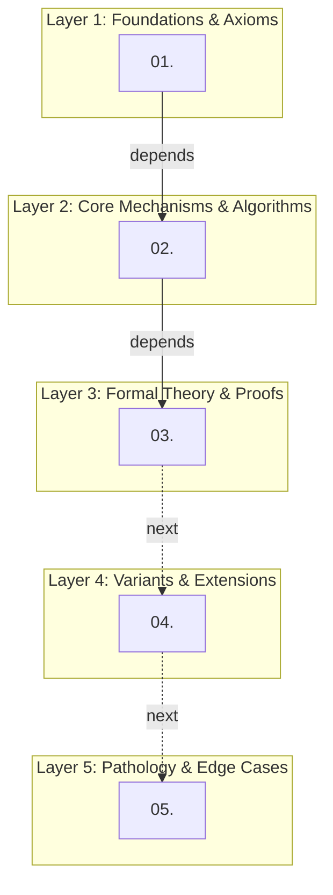

# <Topic Title> — Syllabus & Learning Graph

<!-- AUTHORING CONTRACT:
- Use the [shared decision guide](../shared/notes_decision_matrix.md) before selecting subtopics.
- Write this file FIRST in Wave 1 before any 01-... note is created.
- Nothing outside `allowed_subtopics` may be created during /scribe-deepnotes, /scribe-notes, or /scribe-expand.
- Tangential concepts must be handled with a 2-sentence inline recap + [[link]] (if in vault) or plain text—never a new .md file.
-->

## 1. Scope Boundary Contract
<!-- Gate: DM-01, DM-02, DM-03. KEEP the scope and allowlist. Include out-of-scope entries when they prevent a plausible tangent. Match the saved plan. -->
- **Core Learning Objective:** <!-- 1–2 sentences defining the exact start-to-end boundary of <Topic Title>. -->
- **In-Scope Subtopics (Strict Allowlist):**
  1. `01-<subtopic-1-slug>.md` — <!-- 1-line scope -->
  2. `02-<subtopic-2-slug>.md` — <!-- 1-line scope -->
- **Explicitly Out-of-Scope (Do-Not-Create Fence):**
  - **<Adjacent Topic 1>:** <!-- Why excluded; link target if it exists, else plain text. -->
  - **<Prerequisite Topic 2>:** <!-- Why excluded; 2-sentence recap rule applies. -->

## 2. Detailed Learning-Flow Graph
<!-- Gate: DM-02, DM-13, DM-20. KEEP valid dependency edges. ADAPT graph layers to the actual topic and confirm the order is acyclic. -->

- **Topological Mastery Order:** `01` $\to$ `02` $\to$ `03` $\to$ `04` $\to$ `05`

## 3. Subtopic Manifest & Status Matrix
<!-- Gate: DM-01, DM-19, DM-20. KEEP planned note identities and their real dependencies. Update status from observed publication. -->

| Order | Note | Layer | Prerequisites (`depends_on`) | Next | Status |
|---|---|---|---|---|---|
| 01 | [[01-<subtopic-1-slug>\|<Subtopic 1>]] | L1 Foundations | — | [[02-<subtopic-2-slug>\|<Subtopic 2>]] | planned |
| 02 | [[02-<subtopic-2-slug>\|<Subtopic 2>]] | L2 Core | [[01-<subtopic-1-slug>\|<Subtopic 1>]] | — | planned |
